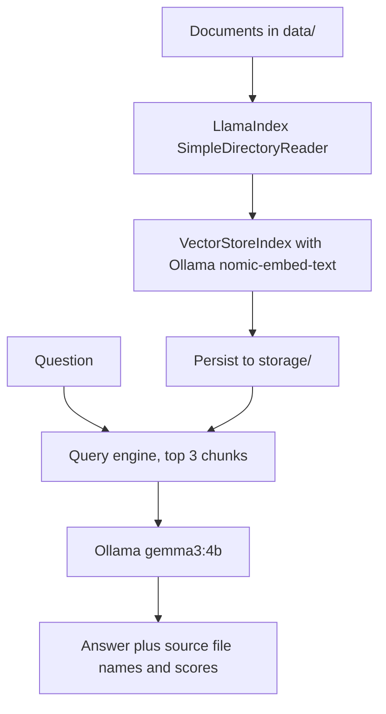
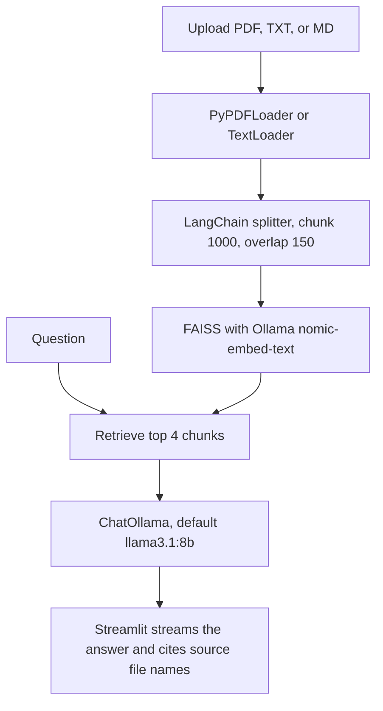
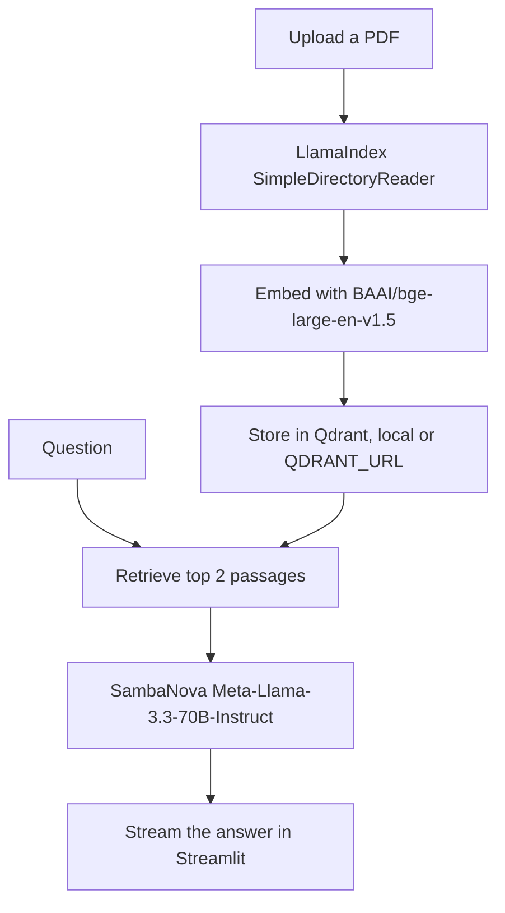
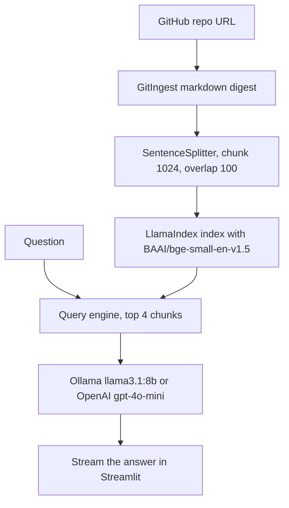

# RAG Projects

A collection of Retrieval-Augmented Generation (RAG) tools. Each project lives in its own folder with its own dependencies and documentation.

## Projects

| Project | Description |
|---------|-------------|
| [SIMPLE RAG](SIMPLE%20RAG/README.md) | Fully local RAG with LlamaIndex and Ollama — no API keys, no cloud |
| [DOCUMENT CHAT RAG](DOCUMENT%20CHAT%20RAG/README.md) | Streamlit chat over your PDFs/TXT with FAISS + Llama via Ollama |
| [FAST RAG](FAST%20RAG/README.md) | Fast cloud RAG with SambaNova Llama 3.3, LlamaIndex, Qdrant, Streamlit |
| [GITHUB RAG](GITHUB%20RAG/README.md) | Chat with a GitHub repo via GitIngest + LlamaIndex, local (Ollama) or OpenAI |

## How it works

### SIMPLE RAG



### DOCUMENT CHAT RAG



### FAST RAG



### GITHUB RAG



## Repository layout

```
BASIC-RAG/
├── SIMPLE RAG/           # Basic local RAG pipeline (LlamaIndex + Ollama)
├── DOCUMENT CHAT RAG/    # Streamlit document chat (LangChain + FAISS + Ollama)
├── FAST RAG/             # SambaNova + LlamaIndex + Qdrant + Streamlit
├── GITHUB RAG/           # GitIngest + LlamaIndex chat over a GitHub repo
└── README.md             # This file
```

Each subproject has its own `README.md`, `requirements.txt`, and `.gitignore`. Install and run from inside the project folder you care about.
